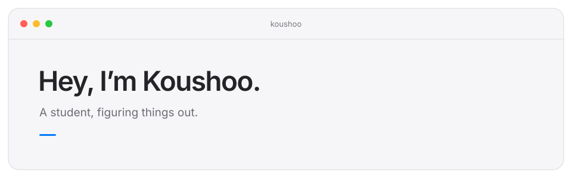
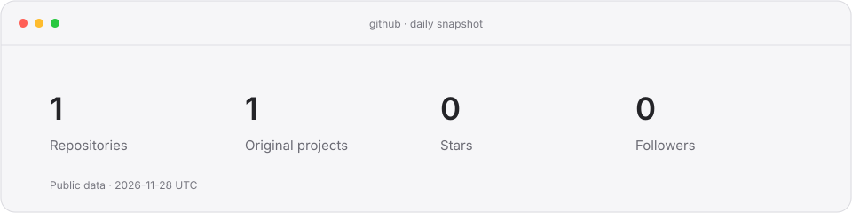

 

I’m a student. This is where I keep the things I work on.

### On my desk

<table>
  <tr>
    <td>
      <a href="https://github.com/Koushoo/liteimagepro"><strong>LiteImage Pro</strong></a> 
      An image compressor for the browser. 
      HTML · CSS · JavaScript
    </td>
    <td>
      <a href="https://github.com/Koushoo?tab=repositories"><strong>The rest of my repos</strong></a> 
      Small projects, experiments, and things in progress.
    </td>
  </tr>
</table>

 

Still learning. One project at a time.

### A little automation

A small Python job on my VPS saves a daily snapshot of my public repos.

[How it works](docs/AUTOMATION.md) · [Original stats project](https://github.com/antonisloukis/minimal-github-stats)
