<picture>
  <source media="(prefers-color-scheme: dark)" srcset="assets/workspace-dark.svg" />
  
</picture>

 

I’m a student. I use this space for small tools and things I’m learning.

### On my desk

<table>
  <tr>
    <td width="50%">
        
      <strong>Quietwatch</strong> 
      An HTTP uptime checker for a VPS. Keeps a local history and tracks when a site goes down or comes back.  
      Python · SQLite · Private source
    </td>
    <td width="50%">
        
      <strong>File Tidy</strong> 
      A duplicate-file finder that checks file contents and reports possible wasted space. Leaves the files alone.  
      Python · SHA-256 · Private source
    </td>
  </tr>
</table>

 

Still learning. One project at a time.

Behind this profile

A small Python job on my VPS saves a daily snapshot of my public GitHub data. The pixel artwork lives in this repo too, so it doesn't need an external image service.

[How it works](docs/AUTOMATION.md) · [Original stats project](https://github.com/antonisloukis/minimal-github-stats)

[Art source](scripts/build_profile_art.py) · [Design notes](docs/PROFILE-ART.md)

