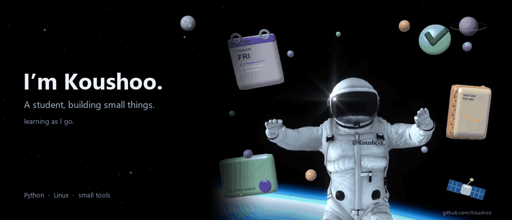

<picture>
  <source media="(prefers-reduced-motion: reduce)" srcset="assets/space-orbit-v3-still.png" />
  <source type="image/webp" srcset="assets/space-orbit-v3.webp" />
  
</picture>

I’m a student. I’m working on small Python and TypeScript tools, with a few experiments on my Linux VPS.

### Projects

- **Margin** — searches Markdown study notes offline, with BM25 ranking and matching snippets.
- **Duegrid** — turns assignment estimates into a daily study plan and flags work that won’t fit before a deadline.
- **Quietwatch** — checks HTTP endpoints and keeps uptime history in SQLite.
- **File Tidy** — finds duplicate files by comparing their SHA-256 hashes. Reports matches without deleting anything.

The project repositories are private for now.

About the profile

A Python job on my VPS saves a daily snapshot of my public GitHub data. The header uses a rendered loop from my local Friday website project. The astronaut scene comes from [Lusion](https://lusion.co/); the floating everyday objects are from the Friday adaptation.

[Automation](docs/AUTOMATION.md) · [Artwork notes](docs/PROFILE-ART.md) · [Stats project used](https://github.com/antonisloukis/minimal-github-stats)

